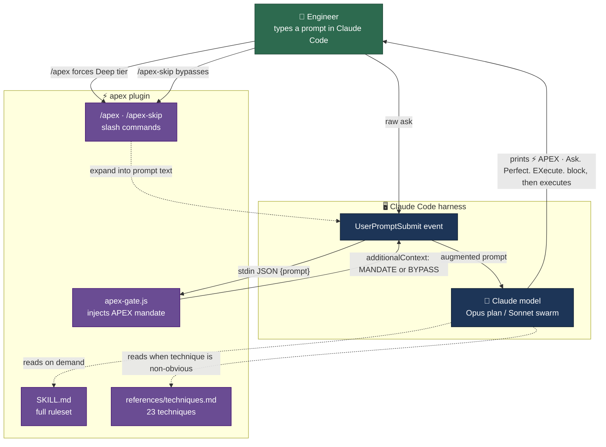
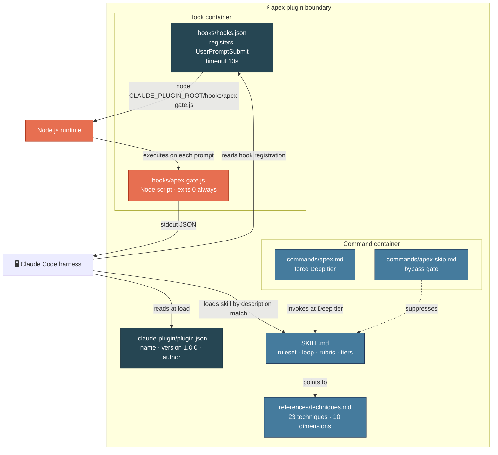
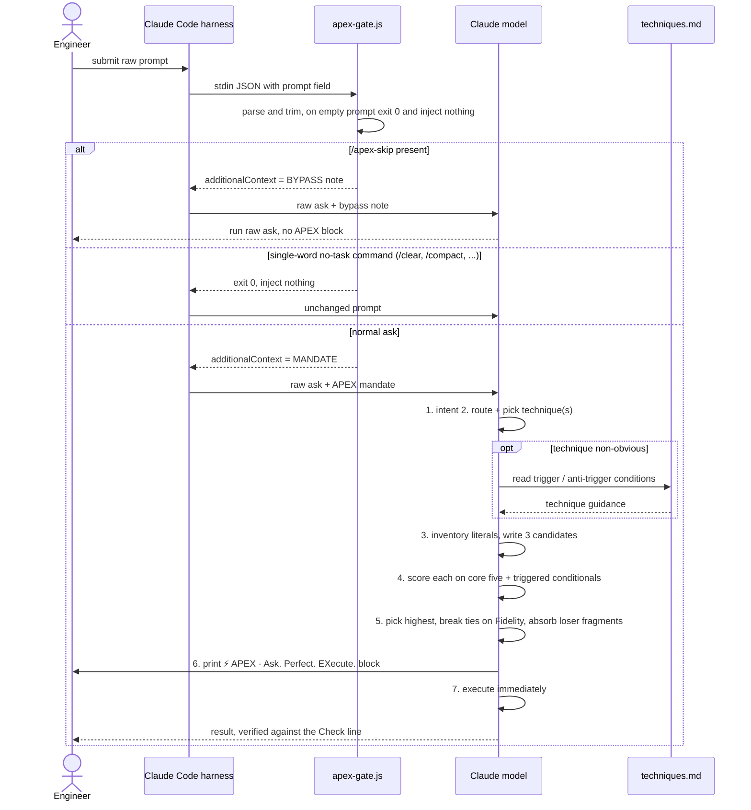
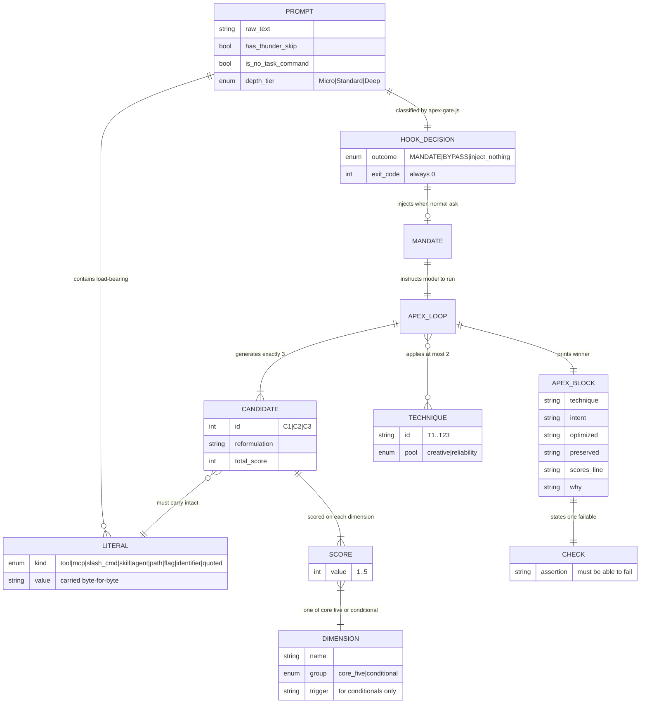
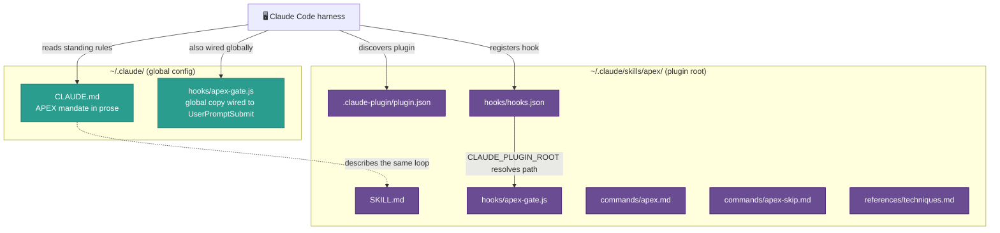

# Architecture brief: apex (APEX)

A Claude Code plugin that intercepts every user prompt and rewrites it into a scored, executable spec before any work starts.

## Table of contents

- [Overview](#overview)
- [Problem definitions and business context](#problem-definitions-and-business-context)
  - [Problem statement](#problem-statement)
  - [Business context](#business-context)
- [C4 system context diagram](#c4-system-context-diagram)
- [System overview](#system-overview)
  - [C4 container diagram](#c4-container-diagram)
  - [Container diagram explanation](#container-diagram-explanation)
  - [Request flow sequence](#request-flow-sequence)
  - [Technology stack](#technology-stack)
- [System data models](#system-data-models)
  - [Data model ER diagram](#data-model-er-diagram)
  - [Data model explanation](#data-model-explanation)
- [Interface surface](#interface-surface)
  - [Entry points](#entry-points)
  - [The APEX output block](#the-apex-output-block)
- [Deployment architecture](#deployment-architecture)
- [Document metadata](#document-metadata)

## Overview

APEX (Ask. Perfect. EXecute.) (APEX) is a Claude Code plugin. It sits on the `UserPromptSubmit` event, so it runs the moment a person hits enter and before the model reads the request. Its job is a single loop: take the raw ask, rewrite it into an executable spec, score three candidate rewrites against a fixed rubric, keep the one that survives, print a short receipt, then execute.

The plugin ships four moving parts: a skill definition (`SKILL.md`) that holds the full ruleset, a hook script (`apex-gate.js`) that injects the mandate into every prompt, two slash commands (`/apex` and `/apex-skip`), and a technique reference library (`references/techniques.md`) holding 23 prompting techniques with trigger and anti-trigger conditions.

Who uses it: a single engineer running Claude Code who wants every prompt disciplined the same way, without remembering to ask for it. The gate is unconditional and depth is proportional. A one-word question gets one line of APEX. A twelve-file refactor gets the full loop plus a resample round.

## Problem definitions and business context

> This section is the foundation of the brief. It grounds every technical choice by establishing why the plugin exists and what it fixes.

### Problem statement

A raw ask is a first draft. It carries the shape of the thought that produced it, not the shape the work needs. That gap shows up as three recurring failures when a person prompts a coding agent:

- **Under-specification.** "Work on the tests" names an activity, not a deliverable. The agent guesses at scope, and the guess is often wrong.
- **Silent literal loss.** A prompt names a tool, a path, a flag, or a quoted string, and the agent paraphrases it away. `git push --force-with-lease` becomes "push the branch", and the safety flag is gone.
- **No completion criterion.** Without a stated check that can fail, "done" is a judgment call. The agent reports success on work it never verified.

Before this plugin, closing that gap depended on the person remembering to write a careful prompt every single time. That is exactly the kind of discipline humans drop under time pressure. Existing prompt-improvement tools run offline or on demand, so they cover the prompts you thought to run them on, not the prompts you fired without thinking.

APEX removes the memory dependency. It hooks the prompt-submit event, so the loop runs on every prompt whether or not the person asked for it. The rewrite is mechanical and scored, so it is repeatable rather than a matter of mood. And it preserves load-bearing literals byte-for-byte, so the safety flag survives.

### Business context

- **Primary users**: A single engineer operating Claude Code, plus any subagents the session spawns. There is no multi-tenant surface.
- **Use cases**: Rewrite an under-specified ask into an executable spec; preserve tool calls, paths, and quoted text through the rewrite; attach a failable completion check to every task; scale rewrite depth to the size of the ask; bypass the loop on trivial lookups.
- **Non-functional requirements**:
  - *Availability*: The hook must never block a prompt. It never throws and always exits 0. A broken gate injects nothing rather than costing the user a turn.
  - *Latency*: The hook has a 10-second timeout. In practice it does string checks and writes JSON, so it returns in milliseconds.
  - *Safety*: The rewrite may never add a side effect the ask did not request. Optimizing "check if the tests pass" into something that also commits and pushes is treated as a defect, not an improvement.
  - *Determinism of contract*: The output block is a fixed, greppable format so downstream tooling and the human eye can both find it.
- **Integration points**: The Claude Code harness (fires the `UserPromptSubmit` hook), the global `CLAUDE.md` mandate that describes the loop in prose, the model-routing rule (plan on Opus, execute on the Sonnet swarm), and sibling standing rules that compose with APEX rather than replace it: caveman mode, anti-ai-writing-style, and execution-guardrails.

## C4 system context diagram

The plugin has one human actor and three systems it touches: the Claude Code harness that fires the event, the model that runs the loop, and the file assets the plugin ships.



The hook is the only always-on path. It runs on every prompt, decides between injecting the full mandate and injecting a bypass note, and hands control back to the harness. The skill and the technique library are pull resources: the model reads them on demand, not on every turn. The slash commands are convenience shortcuts that expand into prompt text the hook still sees.

## System overview

### C4 container diagram

Inside the plugin boundary there are four containers: the manifest, the hook (registration plus script), the commands, and the reference library. The hook is the only executable; everything else is declarative or documentation the model consumes.



### Container diagram explanation

**Manifest** (`.claude-plugin/plugin.json`). Declares the plugin to the harness: `name` apex, `version` 1.0.0, a one-line description, and an author block. The harness reads it at plugin load time.

**Hook registration** (`hooks/hooks.json`). Binds the script to the `UserPromptSubmit` event with a command of `node "${CLAUDE_PLUGIN_ROOT}/hooks/apex-gate.js"`, a 10-second timeout, and a status message of "APEX gate...". `CLAUDE_PLUGIN_ROOT` resolves to the plugin directory, so the registration is location-independent.

**Hook script** (`hooks/apex-gate.js`). The only executable in the plugin. It reads the prompt from stdin as JSON, decides among three outcomes, and writes JSON to stdout. Its contract is strict: never block, never throw, always exit 0. A broken gate must not cost the user a prompt.

**Commands** (`commands/apex.md`, `commands/apex-skip.md`). Two markdown slash commands. `/apex` forces a Deep-tier pass with the full candidate table and scoring shown. `/apex-skip` suppresses the loop for one turn. Both expand into prompt text that the hook still processes.

**Skill** (`SKILL.md`). The full ruleset: the seven-step loop, the preservation rules, the scoring rubric, and the three depth tiers. The harness surfaces it by description match; the model reads it when it needs the detail.

**Technique library** (`references/techniques.md`). 23 techniques, each with when-to-use and when-not-to-use conditions, plus the ten scoring dimensions with their 5-and-1 anchors and a failure-mode table. The model reads it only when a technique choice is non-obvious, not on every ask.

### Request flow sequence

The critical path is a single prompt from keypress to execution. This sequence shows the hook's decision branch and the loop the model runs on the augmented prompt.



The branch order matters. The bypass check runs first, so `/apex-skip` short-circuits everything. Next comes the single-word no-task filter, which drops pure CLI commands like `/clear` without injecting anything. Everything else gets the full mandate. On a normal ask the model then runs the seven steps, reading the technique library only when the routing decision is not obvious.

### Technology stack

**Runtime and languages:**

- Node.js (the hook is a plain Node script using only `process.stdin` / `process.stdout`, no external packages)
- Markdown with YAML frontmatter (SKILL.md, the two command files)
- JSON (plugin.json, hooks.json, and the hook's stdin/stdout payloads)

**Data storage:**

- None. The plugin is stateless. The loop runs online, once per prompt, with nothing precomputed and nothing reused between turns.

**Infrastructure:**

- Claude Code harness (hosts the plugin, fires the `UserPromptSubmit` event, and injects `additionalContext` back into the prompt)
- `CLAUDE_PLUGIN_ROOT` environment variable (resolves the plugin's install path for the hook command)

**AI/ML services:**

- Claude Opus for planning and Claude Sonnet for execution, per the model-routing rule the plugin composes with. The plugin itself calls no model; it shapes the prompt the harness sends.

**Monitoring and security:**

- No authentication surface. The plugin is local to one machine and one user.
- The hook is fail-open by design: any parse error, any exception, and it injects nothing and exits 0.
- The rewrite carries an injection-defense posture for the task it optimizes: untrusted content gets delimited and the model gets grounded in source, per technique T17.

## System data models

APEX stores no data at runtime, so the "entities" here are the conceptual objects the loop manipulates: the incoming prompt, the mandate the hook injects, the candidates the model writes, the rubric it scores against, and the block it prints. The diagram shows how they relate.

### Data model ER diagram



### Data model explanation

**Prompt to hook decision.** Every prompt is classified once by `apex-gate.js` into one of three outcomes: inject the MANDATE, inject the BYPASS note, or inject nothing. The classification is pure string work: a regex for `/apex-skip`, a set membership check for no-task commands, an empty-string guard.

**Literals.** A prompt may contain load-bearing literals: tool and MCP invocations, slash commands, skill and agent names, shell commands, flags, paths, codebase identifiers, and quoted text. The preservation rule binds before scoring. Every candidate must carry the full inventory intact. A candidate that renames, generalizes, or drops one scores 1 on Fidelity and loses.

**Candidates and scores.** The loop generates exactly three candidates, no more and no fewer. Three is the floor and the ceiling. Each candidate is scored on every dimension that applies, 1 to 5.

**Dimensions.** Five core dimensions are always scored: Fidelity, Specificity, Verifiability, Scope, Context. Five conditional dimensions are scored only when the task triggers them: Persona Fit, Critique Loop, Iteration Readiness, Output Parseability, Injection Defense. An untriggered conditional is not scored and not counted. The total is reported as `n/max`, so five core alone is `n/25` and two conditionals added is `n/35`.

**Techniques.** The loop applies at most two techniques, drawn from a creative pool or a reliability pool. `none` is a legitimate value. The technique catalog holds 23 entries.

**Block and check.** The winning candidate becomes the printed `⚡ APEX · Ask. Perfect. EXecute.` block. Its `Check` line is a single assertion that can fail, and it is the completion criterion for the task, not decoration.

## Interface surface

APEX exposes no HTTP endpoints. Its interface is the set of entry points the harness and the user drive, plus the fixed output contract the loop prints.

### Entry points

**Event hook (always on):**

- `UserPromptSubmit` -> `node "${CLAUDE_PLUGIN_ROOT}/hooks/apex-gate.js"` (timeout 10s). Fires on every prompt. Reads stdin JSON, writes `hookSpecificOutput.additionalContext` to stdout. This is the only path that runs unconditionally.

**Slash commands (user-driven):**

- `/apex <request>` - forces a Deep-tier pass. Shows the routing decision, techniques considered, all three candidates in full, the scoring table with untriggered dimensions marked n/a, the resample round, and the final block. Then executes without asking for approval.
- `/apex-skip` - bypasses the gate for one turn. Strips the token, runs the raw ask, prints no APEX block and no note about skipping. Other standing rules in `CLAUDE.md` still apply.

**Skill invocation (model-driven):**

- The `apex` skill is surfaced by description match. The model reads `SKILL.md` for the full ruleset and `references/techniques.md` for technique detail when a choice is non-obvious.

**Hook input and output contract:**

- Input: `{ "prompt": "<raw text>" }` on stdin.
- Output on a normal ask: `{ "hookSpecificOutput": { "hookEventName": "UserPromptSubmit", "additionalContext": "<MANDATE text>" } }`.
- Output on `/apex-skip`: same shape, `additionalContext` set to the BYPASS note.
- Output on a no-task command or empty prompt: nothing written, exit 0.

### The APEX output block

The loop's user-facing contract is one fixed block, kept greppable so the eye and any tooling can find it:

```text
⚡ APEX · Ask. Perfect. EXecute.
Technique: <one or two, or "none">   (omit on Micro asks)
Intent: <one line, deliverable not activity>
Optimized: <the executable spec>
Preserved: <tools / commands / paths carried through>   (omit if none named)
Check: <a check that can fail>
Scores: C1 n | C2 n | C3 n  → winner Cn  (n/max)
Why: <what the winner had that the losers did not>
```

The depth tier sets how much of this shows. Micro prints `Intent` and `Check` only and runs the rest silently. Standard prints the full block, capped at eight lines. Deep prints the full block plus a resample round, all ten dimensions scored with untriggered ones marked n/a, capped at fourteen lines, then hands off to the routing rule: plan on Opus, execute on the Sonnet swarm.

## Deployment architecture

APEX deploys as a local Claude Code plugin. There is no server, no container, and no network dependency. The unit of deployment is the plugin directory.



**Install model.** The plugin lives under `~/.claude/skills/apex/`. The harness discovers it from `plugin.json`, registers the hook from `hooks/hooks.json`, and resolves the script path through `CLAUDE_PLUGIN_ROOT`. The mandate is reinforced two ways: the hook injects it on every prompt, and the global `CLAUDE.md` states it in prose so the rule holds even if the hook path ever fails.

**Failure posture.** The hook is fail-open. On any parse error or exception it injects nothing and exits 0, so a bad deploy degrades to plain Claude Code rather than a blocked prompt. Because the global `CLAUDE.md` carries the same mandate in text, the loop still runs from the model's standing instructions even with the hook disabled.

**Scaling at 10x.** There is no runtime load to scale; the hook does constant-time string work per prompt. The dimension that grows is the technique library. At 10x the current 23 techniques, the model would not read the whole file per ask. The design already anticipates this: the library is a pull resource consulted only when a routing choice is non-obvious, and the routing table in `SKILL.md` narrows the search to a pool before any file read.

## Document metadata

- **Subject**: apex (APEX) plugin, version 1.0.0
- **Plugin root**: `~/.claude/skills/apex/`
- **Source files reviewed**: `SKILL.md` (258 lines), `hooks/apex-gate.js` (124 lines), `hooks/hooks.json`, `commands/apex.md`, `commands/apex-skip.md`, `.claude-plugin/plugin.json`, `references/techniques.md` (554 lines)
- **Author**: Thunder-13
- **Generated**: 2026-09-16
- **Diagram set**: C4 context, C4 container, request-flow sequence, ER model, deployment topology (5 Mermaid diagrams)
