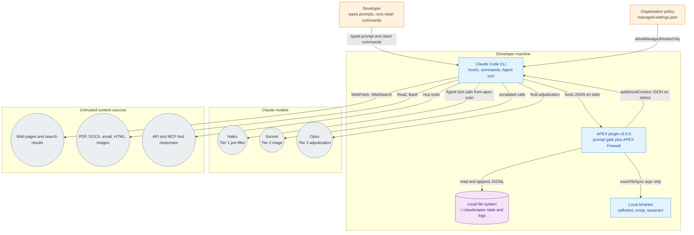
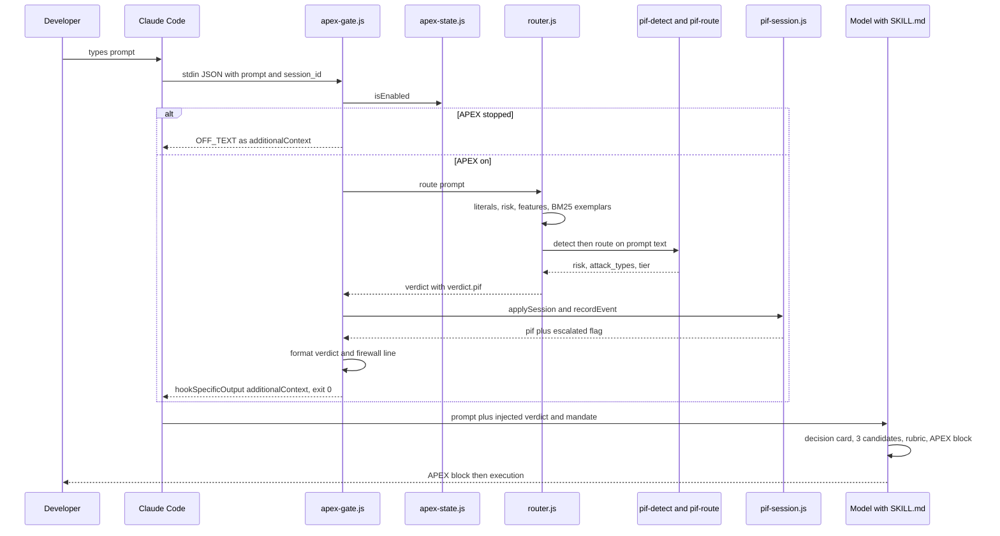
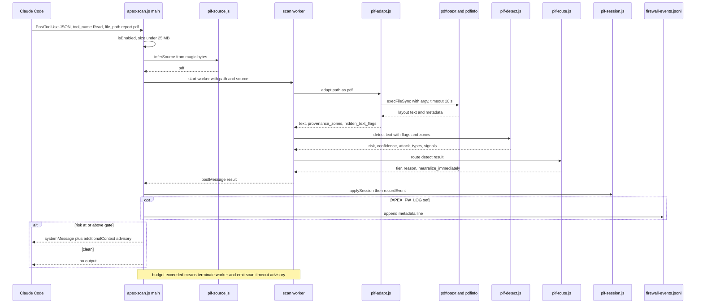
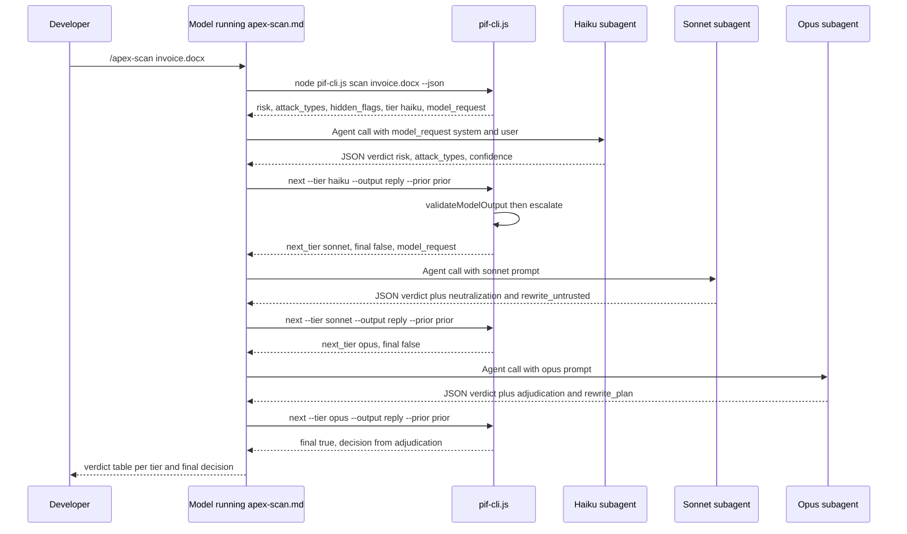
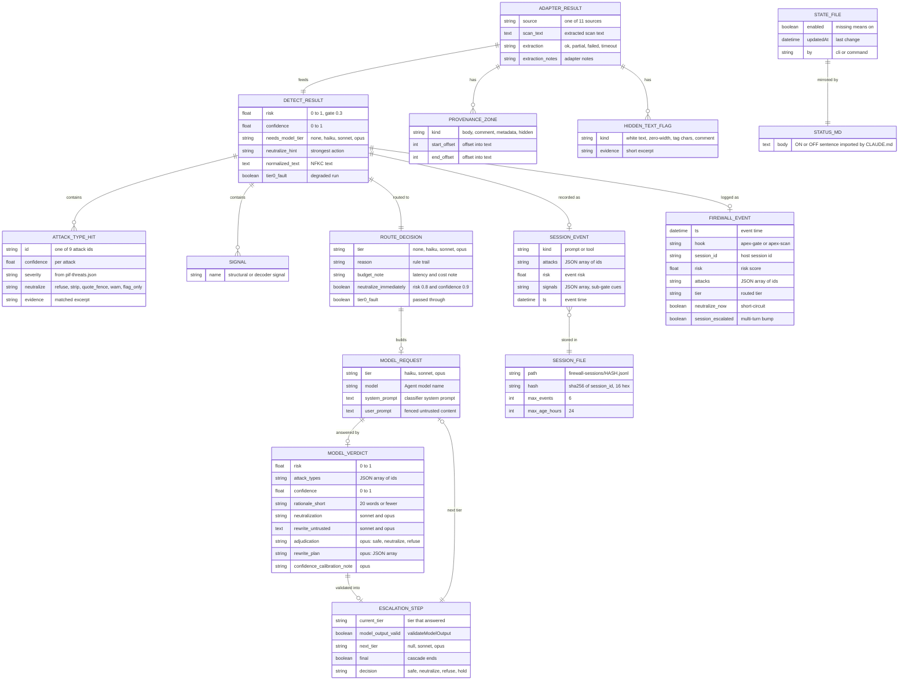
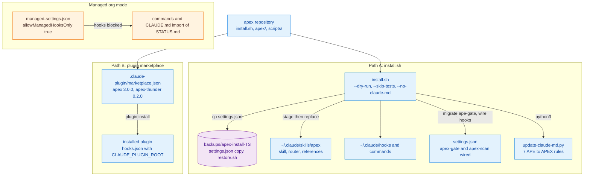

# Architecture brief: APEX v3.0.0

APEX (Ask. Perfect. EXecute.) is a Claude Code plugin with two layers: a prompt optimization gate and the APEX Firewall for prompt injection. This brief covers the v3 repository. The earlier v1 brief lives at `apex/docs/v1-architecture-brief.md`.

| Field | Value |
|---|---|
| Author | Saravanan.R (GitHub Thunder-13) |
| Repository | `Thunder-13/apex` |
| Plugin version | 3.0.0 (`apex/.claude-plugin/plugin.json`) |
| Status line mod | `apex-thunder` 0.2.0 |
| Brief date | 2026-10-11 |

## Table of contents

- [Overview](#overview)
- [Problem definitions and business context](#problem-definitions-and-business-context)
  - [Problem statement](#problem-statement)
  - [Business context](#business-context)
- [C4 system context diagram](#c4-system-context-diagram)
- [System overview](#system-overview)
  - [C4 container diagram](#c4-container-diagram)
  - [Container diagram explanation](#container-diagram-explanation)
  - [Request flow: typed prompt through apex-gate](#request-flow-typed-prompt-through-apex-gate)
  - [Request flow: Read of a poisoned PDF through apex-scan](#request-flow-read-of-a-poisoned-pdf-through-apex-scan)
  - [Request flow: the apex-scan cascade with escalation](#request-flow-the-apex-scan-cascade-with-escalation)
  - [Technology stack](#technology-stack)
- [System data models](#system-data-models)
  - [Data model ER diagram](#data-model-er-diagram)
  - [Data model explanation](#data-model-explanation)
- [Interfaces](#interfaces)
  - [Public interfaces](#public-interfaces)
  - [Internal interfaces](#internal-interfaces)
- [Deployment architecture](#deployment-architecture)
- [Scalability notes](#scalability-notes)
- [Measured results](#measured-results)
- [Code versus summary notes](#code-versus-summary-notes)
- [Document metadata](#document-metadata)

## Overview

APEX runs inside Claude Code on a developer's machine. It has no server, no database and no network calls of its own. Everything is Node.js stdlib code invoked by Claude Code hooks and slash commands, plus a skill file (`apex/SKILL.md`) that the model follows.

Layer one is the prompt gate. On every typed prompt, the `UserPromptSubmit` hook `hooks/apex-gate.js` runs the System One router (`router/router.js`). The router extracts literals, flags destructive risk, scores task type, pool, tier and flags with a learned model (`router/model.json`), and retrieves exemplars from the prompt bank by BM25. The hook injects that verdict as `additionalContext`. The model then runs the System Two APEX loop from `SKILL.md`: a decision card, three candidate rewrites, a ten-dimension rubric, the printed ⚡ APEX block, then execution.

Layer two is the APEX Firewall, built for ET AI Hackathon Problem 2. It looks for 9 attack types across 11 input sources. It scans typed prompts (inside `apex-gate.js`), tool results from `Read`, `WebFetch`, `WebSearch`, `Bash` and `mcp__*` tools (`hooks/apex-scan.js`), and files or text on demand (`/apex-scan`). Tier 0 is deterministic and runs on every hook call. Model tiers (Haiku, then Sonnet, then Opus) run only through `/apex-scan`, where the command drives subagent calls and `pif-cli.js next` validates each verdict and picks the next tier.

Both layers are advisory. The hooks never block, never throw and always exit 0.

Who uses it:

- Developers using Claude Code who want sharper prompts and a warning when untrusted content carries instructions.
- Hackathon judges and reviewers who run `/apex-scan` on attack samples and read the tiered verdict.
- Maintainers who tune the lexicons, the threat catalog (`references/pif-threats.json`) and the router model, then rerun the evals.

## Problem definitions and business context

### Problem statement

1. **Loose prompts give loose work.** A short ask often drops paths, commands or constraints the user had in mind, and the model fills gaps by guessing. APEX rewrites each ask into an executable spec, carries every literal through verbatim, and adds a check that can fail.
2. **Agents read untrusted text.** Claude Code reads files, web pages, API responses and tool output. Any of these can hide instructions: white-on-white PDF text, HTML comments, zero-width or Unicode tag characters, base64 or hex blobs, DOCX comments, OCR text in images. Before APEX there was no local scan between a tool result and the model.
3. **Model-based screening costs money and time on every call.** A cheap deterministic Tier 0 handles the bulk. Only uncertain or high-risk content goes to Haiku, and only harder cases climb to Sonnet or Opus.
4. **Attacks span turns.** A setup in one prompt and a trigger in a later one look benign alone. `pif-session.js` keeps a short, metadata-only event window per session to catch this.
5. **Managed accounts block user hooks.** Under `allowManagedHooksOnly`, hooks do not run. The slash commands and the CLAUDE.md import of `STATUS.md` keep APEX usable there, without the automatic scans.

### Business context

- **Primary users**: individual developers on Claude Code (macOS and Linux), hackathon evaluators, APEX maintainers.
- **Use cases**: optimize a prompt before work starts; warn on injected instructions in a read file or fetched page; run a tiered verdict on a suspect file with `/apex-scan`; turn the gate on or off with `/apex-start` and `/apex-stop`; check hook wiring and org policy with `/apex-doctor`.
- **Non-functional requirements**:
  - Fail open: any error yields exit 0 and, at worst, no advisory.
  - Latency: the hook timeouts are 10 s for the gate and 20 s for the scan, and the scan worker has an 8 s budget (`APEX_FW_SCAN_BUDGET_MS`). Measured scan cost is far lower (see [Measured results](#measured-results)).
  - Privacy: logs are opt-in. Firewall event logs and session files hold metadata only, never prompt or file text. Session files are keyed by a truncated SHA-256 of the session id.
  - Safety of parsing: external binaries run through `execFileSync` with argument arrays, never a shell, with timeouts and output caps. File and decode sizes are bounded.
  - No npm dependencies on the runtime path.
- **Integration points**: the Claude Code hook protocol (JSON on stdin, JSON on stdout), Claude Code slash commands and the Agent tool (for model tiers), local binaries `pdftotext`, `pdfinfo`, `unzip` and `tesseract`, and the local file system under `~/.claude`.

## C4 system context diagram

Legend: orange is people and policy, blue is local processes, purple is local storage, grey is external systems. Claude Code is the only component that talks to models or the network. APEX itself makes no network calls; the `/apex-scan` command text tells the model to fetch URLs with `curl` and to call model tiers through the Agent tool.

## System overview

### C4 container diagram

```mermaid
graph TD
    CC["Claude Code CLI"]

    subgraph HOOKS ["Hook processes - node, one per event"]
        GATE["apex-gate.js<br/>UserPromptSubmit, timeout 10 s"]
        SCAN["apex-scan.js<br/>PostToolUse and PostToolUseFailure, timeout 20 s"]
        WORKER["scan worker<br/>worker_threads, budget 8000 ms"]
        SL["apex-statusline.sh<br/>POSIX sh status line"]
    end

    subgraph ROUTER ["router modules - Node.js stdlib"]
        S1["router.js<br/>System One verdict"]
        LIT["literals.js, risk.js, features.js"]
        BANK["bank.js<br/>BM25 k1 1.2, b 0.75"]
        DET["pif-detect.js<br/>Tier 0, GATE 0.3"]
        SRC["pif-source.js<br/>magic bytes, extensions"]
        ADAPT["pif-adapt.js<br/>11 adapters"]
        ROUTE["pif-route.js<br/>route, escalate, validateModelOutput"]
        SESS["pif-session.js<br/>multi-turn window"]
        CLI["pif-cli.js<br/>scan, text, next"]
        STATE["apex-state.js"]
        DOC["apex-doctor.js"]
    end

    subgraph SKILLCMD ["Model-side assets"]
        SKILL["SKILL.md<br/>APEX loop and rubric"]
        CMDS["commands/*.md<br/>6 slash commands"]
        REFS[("references/<br/>bank-index.min.json, pif-threats.json")]
    end

    subgraph DATA ["~/.claude/apex"]
        STJ[("state.json and STATUS.md")]
        LOGS[("verdicts.jsonl, firewall-events.jsonl")]
        SESSD[("firewall-sessions/HASH.jsonl")]
    end

    subgraph DEVKIT ["Kit and tests - not on the runtime path"]
        TESTS["tests/*.test.js, tests/pif"]
        KIT["tests/pif/kit<br/>74 items, 5 sessions"]
        EVALS["evals/, evals-bank/"]
    end

    CC -->|stdin JSON prompt| GATE
    CC -->|stdin JSON tool_response| SCAN
    CC -->|stdin JSON session| SL
    GATE -->|require| S1
    S1 --> LIT
    S1 --> BANK
    S1 -->|detect on prompt| DET
    GATE -->|applySession, recordEvent| SESS
    SCAN -->|inferSource| SRC
    SCAN -->|workerData| WORKER
    WORKER -->|adapt| ADAPT
    WORKER -->|detect| DET
    WORKER -->|route| ROUTE
    BANK -->|read| REFS
    DET -->|read| REFS
    SESS -->|read and write| SESSD
    GATE -->|APEX_LOG, APEX_FW_LOG| LOGS
    SCAN -->|APEX_FW_LOG| LOGS
    CMDS -->|node bash injection| CLI
    CMDS -->|node| STATE
    CMDS -->|node| DOC
    CLI --> ADAPT
    CLI --> DET
    CLI --> ROUTE
    STATE -->|tmp then rename| STJ
    SL -->|grep enabled| STJ
    TESTS -->|exercise| S1
    TESTS -->|exercise| DET
    EVALS -->|score| S1
    KIT -->|fixtures| TESTS

    classDef proc fill:#e3f2fd,stroke:#1e88e5,color:#0d47a1
    classDef mod fill:#e8f5e9,stroke:#558b2f,color:#1b5e20
    classDef asset fill:#fff3e0,stroke:#ef6c00,color:#4e342e
    classDef store fill:#f3e5f5,stroke:#7b1fa2,color:#4a148c
    classDef dev fill:#eceff1,stroke:#546e7a,color:#263238
    class CC,GATE,SCAN,WORKER,SL proc
    class S1,LIT,BANK,DET,SRC,ADAPT,ROUTE,SESS,CLI,STATE,DOC mod
    class SKILL,CMDS asset
    class REFS,STJ,LOGS,SESSD store
    class TESTS,KIT,EVALS dev
```

### Container diagram explanation

**Hook processes.** Claude Code starts a fresh `node` process per hook event, wired by `apex/hooks/hooks.json`. Each hook enables the V8 compile cache, reads stdin, and resolves its router directory in this order: `$APEX_HOME/router`, the sibling `../router`, then `~/.claude/skills/apex/router`. `apex-gate.js` is the prompt gate. `apex-scan.js` is the tool-result scanner, matched on `^(Read|WebFetch|WebSearch|Bash|mcp__.*)$`. It runs adapt, detect and route in a `worker_threads` worker and kills the worker when the budget runs out, then emits a "scan timeout, content unchecked" advisory. If a worker cannot start, it falls back to an in-process run.

**System One router.** `router.js` builds the verdict: `literals.js` pulls paths, commands and quoted text; `risk.js` classifies destructive operations; `features.js` and `model.json` score task type (16 classes), pool, tier and flags; `bank.js` returns BM25 exemplars from `references/bank-index.min.json`. `router.js` also calls `pif-detect.js` and `pif-route.js` on the prompt and attaches the result as `verdict.pif`.

**Firewall modules.** `pif-source.js` maps a file to one of 11 sources by magic bytes, then extension. `pif-adapt.js` turns the input into scan text plus `provenance_zones` and `hidden_text_flags`. `pif-detect.js` scores the 9 attack types with regexes and keywords from `pif-threats.json`, NFKC normalization, homoglyph checks and decoders (base64, hex, rot13, zero-width and tag characters, decoded recursively to depth 2). `pif-route.js` maps risk, confidence and attack mix to a tier. `pif-session.js` escalates across turns.

**Model-side assets.** `SKILL.md` holds the System Two loop. The six command files in `commands/` either run a `node` script through Claude Code's bash injection or instruct the model step by step (`/apex-scan`, `/apex`).

**State and logs.** `state.json` and `STATUS.md` live under `${CLAUDE_CONFIG_DIR:-~/.claude}/apex`. Logs are opt-in through `APEX_LOG` and `APEX_FW_LOG`. Session files sit under `~/.claude/apex/firewall-sessions`.

**Kit and tests.** Node test files cover the router, literals, risk, org mode, install round trip, performance and the firewall (`tests/pif`: adapters, attacks, CLI, hook, ReDoS, scan). `tests/pif/kit` holds 74 real files over 11 sources and 5 multi-turn sessions. `evals/` and `evals-bank/` hold the v2 router evaluation data.

### Request flow: typed prompt through apex-gate

With `/apex-skip` in the prompt the firewall still runs. The loop is skipped, and if attacks are found the context carries BYPASS plus the firewall line and the firewall mandate. `APEX_FW_DISABLE=1` turns off all firewall work for A/B runs.

### Request flow: Read of a poisoned PDF through apex-scan

### Request flow: the apex-scan cascade with escalation

The command caps the cascade at three model calls. A malformed verdict ends it (`final: true`). Opus is always final. URLs are downloaded with `curl -sSL --max-time 15` into a temp file and scanned as `web_page`. `--text "<prompt>"` scans a string with `pif-cli.js text`.

### Technology stack

**Runtime and languages**

- Node.js, stdlib only (`fs`, `path`, `os`, `crypto`, `child_process`, `worker_threads`). Verified on Node v25.9.0 on the build machine; the code uses `require('node:module').enableCompileCache` when present.
- POSIX `sh` for `apex-statusline.sh`, Bash for `install.sh` and the generated `restore.sh`.
- Python 3 for `scripts/update-claude-md.py` (CLAUDE.md patcher, 7 APE to APEX rename rules).
- TypeScript (`register.tsx`, `types/index.d.ts`) for the optional `mods/apex-thunder` status-line mod.

**Data storage**

- JSON and JSONL files only: `references/*.json`, `router/model.json`, `router/lexicon.compiled.json`, `~/.claude/apex/*.jsonl`. No database.

**External binaries (optional, resolved from fixed paths, no shell lookup)**

- `pdftotext` and `pdfinfo` (Poppler) for PDFs, `unzip` for DOCX parts, `tesseract` for OCR. Search paths: `/opt/homebrew/bin`, `/usr/local/bin`, `/usr/bin`, `/bin`.

**AI and ML**

- Learned router heads in `router/model.json`, fit by `router/fit.js`.
- BM25 retrieval over a compact postings index (`bank.js`, built by `build-bank.js`).
- Claude Haiku, Sonnet and Opus as Tier 1 to Tier 3 classifiers, called by the host through the Agent tool. Budget notes in `pif-route.js`: Haiku under 400 ms, Sonnet under 1.5 s, Opus under 5 s.

**Security controls**

- Advisory output only; exit 0 on every path.
- `execFileSync` with argv arrays and timeouts (pdftotext 10 s, unzip 10 s, tesseract 30 s) and `maxBuffer` caps.
- Size caps: 25 MB file, 20 MB image, 2 MB adapter input, 1 MB scan text, 10 MB decoded, 200 PDF streams, 5 MB inflated.
- A ReDoS test suite (`tests/pif/redos.test.js`) for the threat regexes.

## System data models

### Data model ER diagram

### Data model explanation

- **Flow.** A tool result or file becomes an `ADAPTER_RESULT`, which `detect` turns into a `DETECT_RESULT`. `route` turns that into a `ROUTE_DECISION`. Only `/apex-scan` goes further: the decision's `model_request` is answered by a model, the reply is checked by `validateModelOutput`, and `escalate` returns an `ESCALATION_STEP` that may carry the next request.
- **Tier rules** (`pif-route.js`). Fault passes through. Risk at or above 0.8 with confidence at or above 0.9 short-circuits to neutralize with no model call. Risk under 0.2 passes. `multi_step_jailbreak` or three or more attack categories force Opus. Per-attack minimums apply (Haiku for override, role change, poisoning, encoding; Sonnet for secret, tool, credential, indirect; Opus for multi-step), and six attack pairs bump the tier. Haiku goes to Sonnet when risk is 0.5 or more and confidence under 0.7; Sonnet goes to Opus when risk is 0.85 or more and confidence under 0.75.
- **Session state.** `SESSION_EVENT` rows hold ids, scores and cue signals, never text. Escalation adds `multi_step_jailbreak` at confidence 0.6 or 0.75 when prior flagged events or cumulative sub-gate signals fall in the window.
- **Formats.** All persistent data is JSON or JSONL. `state.json` is written by tmp file plus rename. There is no vector store; retrieval is BM25 over `bank-index.min.json`.
- **Field names.** `PROVENANCE_ZONE`, `HIDDEN_TEXT_FLAG` and `SIGNAL` attributes are summarized from adapter and detector code; the enumerated values are representative, not exhaustive.

## Interfaces

APEX is a local plugin. It exposes no HTTP API. Its contracts are slash commands, CLI entry points and the Claude Code hook protocol.

### Public interfaces

**Slash commands** (`apex/commands/*.md`)

| Command | Runs | Result |
|---|---|---|
| `/apex <ask>` | `router.js --explain`, then the loop at Deep tier | Router hints labeled weak, decision card, candidates, scores, block, execution |
| `/apex-start` | `node router/apex-state.js start` | Writes `state.json` and `STATUS.md`; replies `⚡ APEX on · Ask. Perfect. EXecute.` |
| `/apex-stop` | `node router/apex-state.js stop` | Writes state off; replies `APEX off` |
| `/apex-skip` | Prompt text only | Raw ask runs with no APEX block; the firewall still runs in the gate |
| `/apex-scan <path or URL>` or `--text "<prompt>"` | `pif-cli.js scan` or `text`, then up to 3 `next` rounds | Verdict table per tier and a final decision |
| `/apex-doctor` | `node router/apex-doctor.js` | Config dir, version, state, hooks, commands, status line, org policy, binaries, verdict |

**CLI entry points**

- `node router/pif-cli.js scan <path> [--source <id>] [--json] [--fail-on-risk]`. Output fields: `path, source, extraction, extraction_notes, risk, confidence, attack_types, signals, hidden_flags, tier, reason, budget_note, neutralize_immediately, model_request`.
- `node router/pif-cli.js text "<string>" [--json]`. Same shape for a literal string.
- `node router/pif-cli.js next <path|-> --tier <t> --output '<json>' --prior '<json>'`. Output: `current_tier, model_output_valid, validation_errors, next_tier, final, decision, reason, prior, model_request`.
- Exit codes for `pif-cli.js`: 0 success, 2 usage error, 1 when `--fail-on-risk` is set and attacks are found.
- `node router/router.js --explain "<ask>"` prints a table; `--json "<ask>"` prints the raw verdict.
- `node router/apex-state.js start|stop|status` and `node router/apex-doctor.js` always exit 0.

**Environment switches**

| Variable | Effect |
|---|---|
| `APEX_HOME` | First router directory to try |
| `CLAUDE_CONFIG_DIR` | Config root, default `~/.claude` |
| `APEX_LOG=1` or `full` | Append verdicts (and with `full`, prompt text) to `verdicts.jsonl` |
| `APEX_FW_LOG=1` | Append metadata lines to `firewall-events.jsonl` |
| `APEX_FW_DISABLE=1` | Skip all firewall work (A/B baseline) |
| `APEX_FW_SESSION=0` | Disable session reads and writes |
| `APEX_FW_SCAN_BUDGET_MS` | Scan worker budget, default 8000 |

### Internal interfaces

**Hook contracts** (stdin JSON in, stdout JSON out, exit 0 always)

- `apex-gate.js` on `UserPromptSubmit`: reads `prompt` and `session_id`; writes `{ hookSpecificOutput: { hookEventName: "UserPromptSubmit", additionalContext }, systemMessage? }`. The context holds the verdict (12 lines or fewer), the mandate, and the firewall line plus firewall mandate when active.
- `apex-scan.js` on `PostToolUse` and `PostToolUseFailure`: reads `hook_event_name`, `tool_name`, `tool_input`, `tool_response`; reads files from disk when a path is known (cap 25 MB), else collects strings from `tool_response` (cap 1 MB). Writes `additionalContext` advisories, with a `systemMessage` for actionable risk or a scan timeout. Silent when clean.
- `apex-statusline.sh`: reads the status-line JSON once, runs the chained command in `apex/statusline-chain` if present, prints `⚡ APEX` joined with ` · ` when on.

**Module functions**

| Module | Exports |
|---|---|
| `router.js` | `route(prompt) -> verdict`, `format(verdict)`, `explain(verdict)`, `TASK_TYPES, POOLS, TIERS, FLAGS, BUILTIN_TECH_IDS` |
| `bank.js` | `retrieveExemplars`, `getIndex`, `tokenize` |
| `literals.js` | `extractLiterals`, `extractInjectionPhrases`, `buildPreserveLine` |
| `risk.js` | `classifyDestructive`, `isSafeRmTarget` |
| `features.js` | `extractFeatures`, `extractFeaturesRegex`, `getLexicons`, `tokenizeLex` |
| `pif-source.js` | `inferSource(opts) -> source id`, `SOURCE_BY_EXT` |
| `pif-adapt.js` | `adapt(content, source) -> { text, provenance_zones, hidden_text_flags, extraction, ... }`, `SOURCES` |
| `pif-detect.js` | `detect(text, metadata) -> detect result`, `loadThreats`, `ATTACK_IDS`, `GATE` |
| `pif-route.js` | `route(detect) -> decision`, `buildPrompt(tier, ctx)`, `validateModelOutput(tier, out) -> { valid, errors }`, `escalate(tier, out, detect) -> { next_tier, final, decision, reason }`, `TIERS`, `ESCALATION` |
| `pif-session.js` | `recordEvent(session_id, { kind, attacks, risk, signals })`, `applySession(pif, session_id, { now, prompt }) -> { pif, escalated, reason }` |
| `apex-state.js` | `readState`, `isEnabled`, `setEnabled(bool, by)`, `stateFile`, `stateDir`, `configDir`, `writeStatusMd` |

All firewall functions are documented as pure or never-throwing; errors become `tier0_fault: true` or an empty result.

## Deployment architecture

- **install.sh** (Bash, idempotent). Resolves `CLAUDE_CONFIG_DIR`, backs up `settings.json` to `backups/apex-install-<timestamp>/`, runs the firewall tests unless `--skip-tests`, stages `apex/` in a temp dir (keeping existing `docs/` and adding `DESIGN.md` as `docs/v2-design.md`), replaces `~/.claude/skills/apex`, installs hooks and commands, creates `state.json` and `STATUS.md` if absent, migrates legacy `ape-gate` and `pif-scan` entries, and patches CLAUDE.md through `scripts/update-claude-md.py` unless `--no-claude-md`. The patcher exits 3 and writes nothing when a rule does not match.
- **restore.sh**. Generated into the backup dir. It restores `settings.json` (including the original `statusLine`), removes artifacts the install created, and, when CLAUDE.md was patched, restores it from its backup.
- **Marketplace install**. The repo root `.claude-plugin/marketplace.json` lists `apex` (source `./apex`) and `apex-thunder` (source `./mods/apex-thunder`). The plugin's `hooks/hooks.json` uses `${CLAUDE_PLUGIN_ROOT}`. Use one path, not both: `install.sh` warns that a marketplace install on top of manual settings entries gives double hooks.
- **Managed org mode**. When `managed-settings.json` (`/Library/Application Support/ClaudeCode/` or `/etc/claude-code/`) sets `allowManagedHooksOnly`, no APEX hook runs. `/apex-doctor` reports `Hooks: BLOCKED by organization policy`. The model still follows `STATUS.md` through CLAUDE.md, and `/apex`, `/apex-scan`, `/apex-start` and `/apex-stop` still work. Automatic prompt and tool-result scans are lost in this mode.

## Scalability notes

APEX runs once per user on one machine, so "10x load" means 10x prompts, tool calls or content size in a session.

| Component | Today | At 10x |
|---|---|---|
| `apex-gate.js` | One node process per prompt; compile cache on | Process start dominates. A long-lived local daemon over a socket would remove the per-call start cost |
| `router.js` and `bank.js` | BM25 over a compact in-memory index loaded per call | A 10x larger bank grows load time linearly; shard the index or memory-map postings |
| `apex-scan.js` and worker | One worker per tool call, 8 s budget, 1 MB text cap | Caps hold per-call cost flat; many parallel tool calls mean many workers, so a shared worker pool would help |
| `pif-adapt.js` | External binaries per file, 10 to 30 s timeouts | OCR is the slow path; cache results by file hash and mtime |
| `pif-detect.js` | Regex and keyword scan, ReDoS-tested | Linear in text size, bounded by the 1 MB cap |
| `pif-session.js` | Rewrites a 6-event JSONL per call | Constant size per session; 24 h pruning keeps the directory small |
| Logs | Append-only JSONL, opt-in | Add rotation; files grow without bound today |
| Model tiers | Only on `/apex-scan`, 3 calls max | Cost scales per scan; the short-circuit and pass rules keep most content at Tier 0 |

## Measured results

Figures from `apex/README.md`. The dev corpus and kit are in-sample.

| Set | Result |
|---|---|
| Dev corpus, 106 rows | micro F1 0.915 (P 0.852, R 0.989), benign flags 0/49 |
| Held-out blind, 90 rows | micro F1 0.464 (P 0.690, R 0.349), benign flags 2/32 (6.3%) |
| Kit, 74 items over 11 sources | 55/74 (baseline 30/74) |
| Kit sessions | 5/5 |
| Hook latency, p50 | about 80 to 120 ms per text file, 170 to 190 ms with OCR |

The held-out run misses the project's own targets. Tier 0 catches known phrasing and misses novel variants; the README names a live Tier 1 classifier as the main open item.

## Code versus summary notes

- Exemplar retrieval reads `references/bank-index.min.json`, the compact form, rather than `bank-index.json`.
- `apex/README.md` gives text-file latency as 80 to 120 ms; the brief follows the README.
- `pif-session.js` writes under `os.homedir()/.claude/apex/firewall-sessions` and ignores `CLAUDE_CONFIG_DIR`, unlike `apex-state.js` and the hooks.
- Model tiers never run on the hook path. Both hooks stop at Tier 0 plus routing; Haiku, Sonnet and Opus run only inside `/apex-scan`.

## Document metadata

| Field | Value |
|---|---|
| Title | Architecture brief: APEX v3.0.0 |
| Author | Saravanan.R (GitHub Thunder-13) |
| Path | `docs/apex-architecture-brief.md` |
| Previous brief | `apex/docs/v1-architecture-brief.md` |
| Sources read | `apex/hooks/`, `apex/router/`, `apex/commands/`, `install.sh`, `scripts/update-claude-md.py`, `apex/README.md`, `.claude-plugin/marketplace.json` |
| Date | 2026-10-11 |
